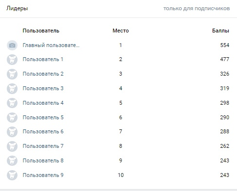
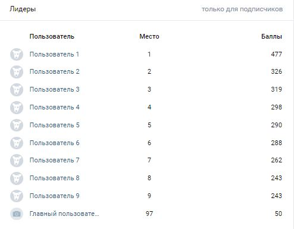
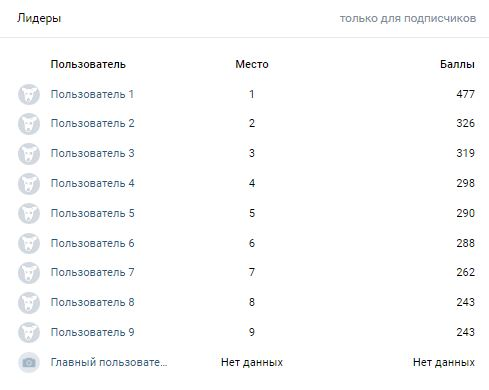

# VKStars

Reward points for activity in a VKontakte group

## Features
- Award points for: posts, likes, reposts, comments, subscriptions  
- “Leaderboard” widget in the group  
- Top 10 display + personal score view

## Screenshots
If you’re in the top 10:  
  

If you’re outside the top 10:  
  

If no record:  
  

## Requirements
- Python 3.8+  
- Libraries listed in `requirements.txt`

## Installation
1. Clone the repository  
2. Enter project directory  
3. Install dependencies  
   ```bash
   pip install -r requirements.txt
   ```

## Configuration
In `data/settings.py`, set:
- `USER_TOKEN`, `WIDGET_TOKEN` — VK tokens
- `GROUP_ID` — VK group ID
- `CONFIRMATION_STRING`, `SERVER_SECRET_KEY` — for callback server
- Points per action (`FOR_LIKE`, `FOR_POST`, etc.)

## Usage
1. Gather stats and fill the database:
   ```bash
   python get_stats.py
   ```
2. Run the app:
   ```bash
   python app.py
   ```
   - starts Flask server and updates widget every 5 minutes.

Project Structure
```
├── data/
│   └── settings.py
├── database/
│   ├── schemas/      # SQLAlchemy models
│   └── db.py
├── utils/
│   ├── filters.py    # point calculation logic
│   └── vk_exceptions.py
├── vk/
│   ├── api.py        # VK API calls
│   ├── execute/      # code for execute-method requests
│   └── update_widget.py
├── web_app/          # Flask callback for VK events
├── get_stats.py      # imports users, posts, likes, reposts, comments
├── app.py            # server launch & widget updater
└── docs/             # screenshots for README
```
